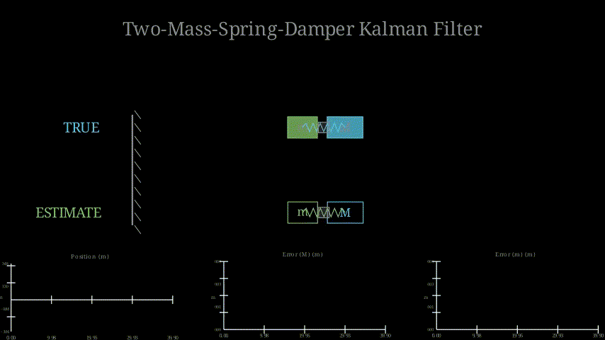

# determined
A lightweight library for some basic filtering methods

## Documentation

This crate implements small Kalman and Extended Kalman Filters on nalgebra
matrices. The models are generic over the dimension type, so the same
implementation serves statically sized matrices (`KalmanFilterNM<N, M>`,
`LinearUpdateNM<N, M>`, ... for predictable, allocation-free linear algebra)
and runtime sized ones (`KalmanFilterDyn`, `ExtendedKalmanFilterDyn`), which
the Python bindings wrap.

Generate API documentation locally with:

```bash
cargo doc --open
```

The main modules are:
- `crate::common` — core traits and type aliases (includes `Algorithm` trait).
- `crate::algorithms` — Kalman and EKF implementations.
- `crate::state` — small `State<R,C>` wrapper around nalgebra matrices.
- `crate::measurement` — measurement/observation helpers.
- `crate::models` — traits for state transition and measurement models used by EKF.

## Development environment

A [Nix](https://nixos.org) flake provides the Rust toolchain, Python (with `numpy`, `pytest` and [Manim Community](https://www.manim.community) including its native dependencies such as cairo and pango) and `maturin`:

```bash
nix develop
cargo test
```

## Python

Build and install the bindings into the current virtualenv with [maturin](https://www.maturin.rs):

```bash
pip install maturin
maturin develop --release      # editable-style install for development
# or
pip install .                  # builds and installs a wheel (needs a Rust toolchain)
```

Then `import determined as dt`.

Six filters are available from Python:

| Class | Models | Maths runs in |
|---|---|---|
| `dt.KalmanFilter(state, *, f, q, h, r)` | numpy matrices | Rust only |
| `dt.ExtendedKalmanFilter(state, *, f, jac_f, q, h, jac_h, r)` | Python functions | Rust, calling back into Python for the model functions |
| `dt.UnscentedKalmanFilter(state, *, f, q, h, r, alpha=1, beta=2, kappa=0)` | Python functions, no Jacobians | Rust, calling back into Python for the model functions |
| `dt.UDKalmanFilter(state, *, f, q, h, r)` | numpy matrices | Rust only, in UD factorised form |
| `dt.UDExtendedKalmanFilter(state, *, f, jac_f, q, h, jac_h, r)` | Python functions | Rust, in UD factorised form, calling back into Python for the model functions |
| `dt.CustomFilter(update)` | a Python `UpdateModel` you implement | Python (the filter only delegates `predict`/`update`) |

```python
kf = dt.KalmanFilter(state, f=F, q=Q, h=H, r=R)
kf.predict(dt.Epoch(1))
kf.update(dt.Observation(z, epoch=dt.Epoch(1)))
```

`dt.ExtendedKalmanFilter` runs the filter maths in Rust and calls back into Python for the model:

```python
ekf = dt.ExtendedKalmanFilter(state, f=f, jac_f=jac_f, q=q, h=h, jac_h=jac_h, r=r)
ekf.predict(dt.Epoch(1))
ekf.update(dt.Observation(z, epoch=dt.Epoch(1)))
```

- **Model functions** are `f(x, t)`, `jac_f(x, t)`, `h(x, t)` and `jac_h(x, t)`. `x` is the state value (a numpy array) and `t` the integer epoch: `f` advances the state from epoch `t` to `t + 1`, and `h` is evaluated at the measurement epoch. They may be time-varying, and may return anything array-like, so Jacobians can come from an autodiff library (e.g. `jax.jacfwd`, which differentiates `x` and not `t`).
- **Same implementation as Rust:** each Python filter wraps the crate's `...Dyn` filter of the same name (`KalmanFilterDyn`, `ExtendedKalmanFilterDyn`, `UnscentedKalmanFilterDyn`, `UDKalmanFilterDyn`, `UDExtendedKalmanFilterDyn`), so they behave exactly like the Rust filters.
- **UD filters:** the covariance is held as factors `P = U D Uᵀ` (`U` unit upper triangular, `D` diagonal), propagated by weighted modified Gram–Schmidt and updated one scalar measurement at a time with the modified Agee–Turner update, following Ramos et al., [*A summary on the UD Kalman Filter*](https://arxiv.org/abs/2203.06105). A non-diagonal `R` is decorrelated first. This keeps `P` symmetric positive semi-definite by construction; the results equal the standard filters up to rounding. The state still carries `P = U D Uᵀ`, and setting it from outside refactorises.
- **Unscented filter:** `f` and `h` are evaluated at 2N + 1 sigma points per step (van der Merwe scaled points), so they must not keep state between calls. The default `alpha=1, beta=2, kappa=0` keeps all sigma point weights non-negative; a very small `alpha` (e.g. `1e-3`) gives a large negative centre weight and is numerically fragile. The covariance must be strictly positive definite (and `kappa > -N`): a semi-definite covariance, such as one with a component known exactly, or a missing one makes `predict`/`update` log an error and leave the state unchanged.
- **Epochs:** both filters advance the state one epoch at a time and do nothing when asked for the current epoch. Predicting backwards uses `F⁻¹` for `KalmanFilter`; the other filters log a warning and leave the state unchanged.
- **Errors in model functions:** if `f`, `h` or a Jacobian raises (or returns the wrong shape), the exception propagates and the filter state is left as it was before the call.
- **Keyword-only arguments:** constructors take their first argument positionally and the rest by keyword, e.g. `dt.State(value, covariance=cov, epoch=epoch)`.
- **States are live views.** To avoid copying, the `State` returned by `predict`, `update` and `.state` shares memory with the filter's internal state, so it changes on the next call (and is the same object you passed in). Copy the arrays (`state.value.copy()`) if you need to keep a snapshot.
- **Logging:** messages from the Rust side go through Python's `logging` under the name `determined`, e.g. `logging.getLogger("determined").setLevel(logging.DEBUG)`.

See `examples/ekf.py`, `examples/ukf.py` and `examples/ud.py` (Rust equivalents: `simple_ekf.rs`, `simple_ukf.rs`, `simple_ud.rs`). Build a distributable wheel with `maturin build --release`.

## Examples


Check out examples for `python` bindings and the core `rust` library in `/examples`.  To run `rust` examples use `cargo`:
```bash
cargo run --example <example_name>
```

To run the visualisation example using `python` and `manim` use:
```bash
manim -pql examples/manim_two_mass_spring_damper.py TwoMassSpringDamperScene
```

## Roadmap

- **Gating:** expose the innovation `y = z - h(x)`, its covariance `S` and the normalised innovation squared `yᵀ S⁻¹ y` from `update`, so outlier measurements can be rejected against a chi-squared threshold. Not exposed yet.
- **Automatic Jacobians:** optional `jac_f` / `jac_h` computed by autodiff or finite differences.
